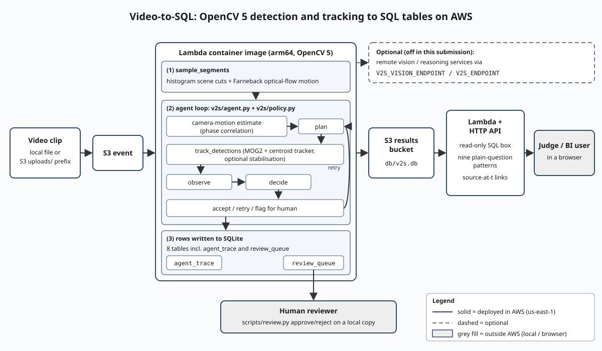
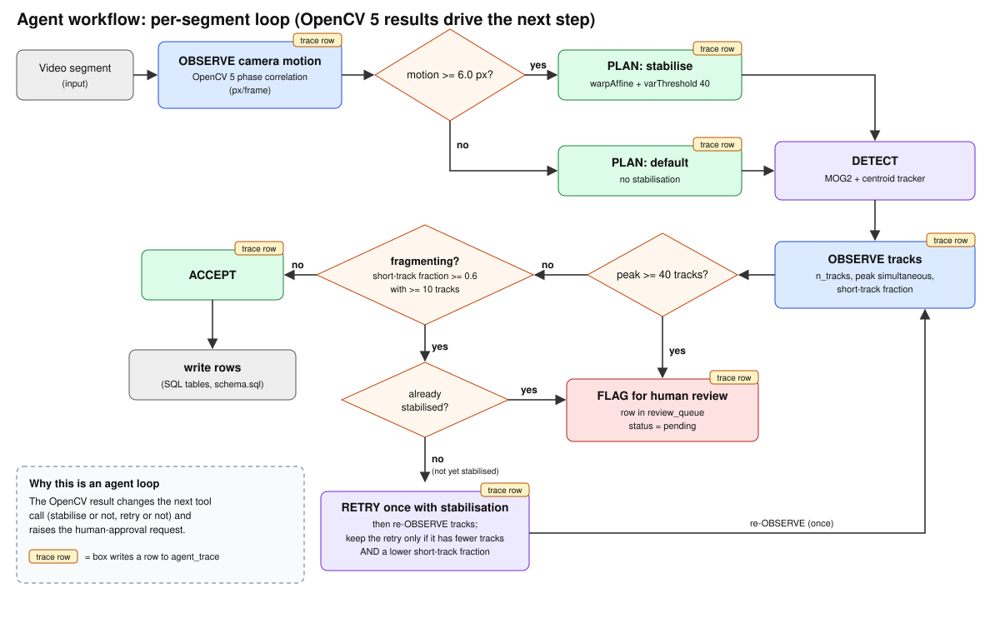

# vid2sql: video in, SQL out

vid2sql turns video into relational tables that a BI user can query with SQL or a plain question. A clip goes in; segments, moving objects, events and per-minute counts come out as rows with timestamps. Every row can be traced back to a second in the source video.

Track: Agentic Vision with OpenCV 5 - OpenCV AI Competition 2026, powered by AWS. OpenCV 5 runs the vision (v2s/core_cv.py), v2s/agent.py and v2s/policy.py run the agent loop, and the AWS component is deploy/template.yaml (Lambda arm64 + S3 + HTTP API).  
License: MIT (see LICENSE).  
Live endpoint: https://doll-vehicles-creativity-into.trycloudflare.com/  
Live endpoint runs on a temporary Cloudflare Quick Tunnel (up to 200 concurrent requests, no uptime guarantee); it is not a production deployment. An AWS deployment (stack vid2sql-dev2, us-east-1) is also running at https://kb7r2uzvgc.execute-api.us-east-1.amazonaws.com/ and answers 503 'no database yet' until a video is uploaded to its S3 upload bucket; deploy/template.yaml is provided for permanent production use.  
Demo video: https://youtu.be/Gq840t5y5s0  
Repository: https://github.com/DKJager/vid2sql  
Technical report: docs/REPORT.md  
Diagrams:  

## Judge quick test (2 minutes)

Open the live endpoint. Press the five example buttons. Click a "source at t" link. Before the first upload the endpoint answers 503 "no database yet: upload a video first".

## What the agent does

The agent loop (v2s/agent.py + v2s/policy.py) runs per segment:

1. OBSERVE camera motion (OpenCV 5 phase-correlation, px per frame at analysis width).
2. PLAN: if motion >= 6.0 px, stabilise (warp + varThreshold 40.0); otherwise use default settings.
3. DETECT with the chosen settings.
4. OBSERVE the tracks (n_tracks, peak simultaneous, median track seconds, share of tracks shorter than 0.5 s).
5. DECIDE: peak simultaneous >= 40 → flag for a human (row in review_queue, status pending); else if >= 10 tracks and short-track share >= 0.6: not yet stabilised → RETRY once with stabilisation and keep the retry only if it has fewer tracks AND a lower short-track share; already stabilised → flag for a human; else accept.

Every step is a row in table agent_trace. A human approves or rejects flagged segments on a local database copy with scripts/review.py.

Example trace rows (from evidence/agent_trace_real.md):

| start_s | end_s | step | decision | reason | observation |
|---|---|---|---|---|---|
| 0.00 | 3.04 | plan | default | Camera motion 1.83 px is below 6.0 px, so the detector runs with default settings. | camera_motion_px=1.8291 |
| 0.00 | 3.04 | review | accept | 55 tracks, peak 28 simultaneous, short-track fraction 0.35; accepted. | duration_s=3.04, median_track_s=0.76, n_tracks=55, peak_simultaneous=28, short_track_fraction=0.3455 |
| 3.04 | 18.64 | plan | default | Camera motion 0.21 px is below 6.0 px, so the detector runs with default settings. | camera_motion_px=0.2055 |
| 3.04 | 18.64 | review | accept | 140 tracks, peak 22 simultaneous, short-track fraction 0.29; accepted. | duration_s=15.6, median_track_s=0.88, n_tracks=140, peak_simultaneous=22, short_track_fraction=0.2857 |

## Quick start

From clone to rows:

```bash
git clone https://github.com/DKJager/vid2sql vid2sql
cd vid2sql
python3.12 -m venv .venv
.venv/bin/pip install -r requirements.txt
.venv/bin/python -m pytest -q
.venv/bin/python scripts/fetch_clips.py          # downloads the three CC clips, verifies SHA-256
.venv/bin/python scripts/run_real_clips.py       # runs the OpenCV 5 pipeline -> out/real_clips.db
.venv/bin/python scripts/ask.py --db out/real_clips.db "When is each video busiest?"
V2S_DB_PATH=out/real_clips.db .venv/bin/python web/app.py
.venv/bin/python scripts/export_trace.py out/real_clips.db
.venv/bin/python eval/synth_eval.py
.venv/bin/python eval/calibrate_policy.py
```

## What runs where

All vision is OpenCV 5 (`opencv-python-headless==5.0.0.93`, local only; no network call, no model weights):

| Function | OpenCV 5 API | File |
|---|---|---|
| Scene-cut detection | cv2.calcHist, cv2.compareHist | v2s/core_cv.py |
| Motion sampling | cv2.calcOpticalFlowFarneback | v2s/core_cv.py |
| Background subtraction | cv2.createBackgroundSubtractorMOG2 | v2s/core_cv.py |
| Morphology | cv2.morphologyEx | v2s/core_cv.py |
| Contour extraction | cv2.findContours, cv2.moments, cv2.boundingRect | v2s/core_cv.py |
| Camera-motion estimate | cv2.phaseCorrelate, cv2.createHanningWindow | v2s/core_cv.py |
| Stabilisation | cv2.phaseCorrelate, cv2.warpAffine (BORDER_REPLICATE) | v2s/core_cv.py |
| Analysis resize | cv2.resize (INTER_AREA, <= 480 px width) | v2s/core_cv.py |

## Tables

Eight tables (v2s/schema.sql; Athena DDL v2s/schema.athena.sql): videos, segments, events, objects, counts, transcript (always empty), agent_trace, review_queue.

## What the tests cover
The suite has 132 tests (132 passed, OpenCV 5.0.0; log sha256 b693c22d52ec6da3adf4d20aeb2b8b87ab183f16cf57733f8c6a6b71945ca6cc). Tests that run the real OpenCV code with no stubs: tests/test_core_cv.py (14), tests/test_opencv5.py (7), tests/test_agent_policy.py (5, real detector on synthetic video), tests/test_export_trace.py (5, real sqlite including evidence/real_clips.db), and tests/test_real_clip_pipeline.py (1: the real clip clip1_slovenska.webm end to end, object count equal to evidence/real_ab.json; skipped when data/clips is absent). Only clip1 is run end to end in the tests. The stub remains: tests/test_agent_loop.py (3 tests) replaces the sampler and detector transports and the crowd client with local stubs, so it tests the agent-loop logic, not vision.

## Evaluation and failure cases

Evidence files are in evidence/. There is no human-annotated ground truth for the real clips, so no precision or recall is claimed.

**Real clips, agent off vs on** (evidence/real_ab.json):

| Clip | Tracks off/on | Review flags |
|---|---|---|
| clip1_slovenska.webm (handheld, 18.7 s) | 159 / 159 | 0 |
| clip2_shibuya.webm (fixed, 58.6 s) | 700 / 700 | 2 |
| clip3_cobbled.webm (cobbled street, 16.4 s) | 107 / 107 | 1 |

**Synthetic scenarios with exact ground truth** (evidence/synth_eval.json):

| Scenario | Truth | Off | On | Motion px | Review flags |
|---|---|---|---|---|---|
| steady | 3 | 4 | 4 | 0.3063 | 0 |
| jittery | 3 | 3 | 3 | 3.3769 | 0 |
| crowd | 45 | 8 | 8 | 0.1942 | 0 |
| slow_stop | 1 | 0 | 0 | 0.2371 | 0 |

**Calibration study** (evidence/calibration.json; 14 synthetic scenarios, 3 runs each): with the chosen motion threshold of 6.0 px the mean object-count error is 0.7857. Always-stabilise gives 0.7857; never-stabilise gives 0.9762.

**Real-clip statistics** (evidence/eval_real.json): determinism check passed, invariant violations [].

| Clip | Tracks | Peak simultaneous | Track-seconds fraction | Scene segments |
|---|---|---|---|---|
| clip1 | 159 | 44 | 0.947 | 2 |
| clip2 | 700 | 101 | 0.983 | 4 |
| clip3 | 107 | 43 | 0.882 | 3 |

This project does not claim accuracy, precision, recall on real footage, COOL/Graviton performance, human-labelled ground truth, or any figure not in the evidence files listed above.

## Timestamps

Event times are absolute UTC: events.start_timestamp_utc = clip recording start + in-video offset (segments.start_s). The recording start comes from the clip metadata (recording_start_utc: optional CSV column in data/CLIPS.csv, or S3 object metadata key recording-start-utc on upload); when a clip has none, the pipeline anchors at videos.processed_at_utc, sets videos.recording_start_utc = videos.processed_at_utc and logs a WARNING, so those event times are processing-relative; process_clip(..., require_recording_start=True) refuses such clips instead. The three bundled Wikimedia clips carry no recording time, so their event times are processing-relative; in-video offsets (segments, objects) are exact.

## AWS deployment

deploy/template.yaml defines an S3 upload bucket, a container-image Lambda (arm64, pipeline), a results bucket, and a QueryFunction Lambda behind an API Gateway HTTP API. The public endpoint is read-only and throttled; the database has one writer at a time. See deploy/README.md for build and deployment steps. Stack name: vid2sql-dev2 (us-east-1). Delete after judging: sam delete --stack-name vid2sql-dev2.

## Limitations

- Moving objects only: the detector labels everything moving_object. A stationary person is not detected. No classification is performed.
- Track counts are inflated by fragmentation and are not head counts. Peak simultaneous tracks is more meaningful but still over-estimates in dense scenes.
- Handheld or shaky footage creates false tracks on static background. The agent's stabilisation reduces some false tracks but there is no ground truth to prove accuracy.
- Scene-cut detector is crude; histogram changes from exposure and large moving objects trigger false cuts.
- The retry path (stabilise again) did not improve the two fragmenting segments it was tried on; the trace shows keep_first.
- Crowd undercount: the synthetic crowd scenario (truth 45) produced 8 tracks.
- The transcript table is empty; no speech component is wired in.
- No evaluation has been run on labelled real footage.
- Lambda performance has not been measured.
- The endpoint is public and unauthenticated.
- SQLite in S3 limits writes to one concurrent caller.

## Responsible use

- Only licensed footage with recorded licence and source is processed.
- No faces, identities, licence plates or biometrics are extracted or stored. The pipeline outputs class-less moving_object bounding boxes only; no frames are stored.
- Uploaded objects expire after 14 days.
- The query endpoint is read-only and throttled.
- The agent escalates dense or fragmenting scenes to a human instead of guessing.
- This system is not designed for surveillance of individuals.
- Fictional and synthetic test fixtures are labelled as such.

## Repository map

- v2s/ — core pipeline, agent, schema, NLQ
- web/ — Flask query endpoint
- deploy/ — AWS Lambda handlers and CloudFormation template
- scripts/ — fetch clips, run pipeline, ask questions, review, export trace
- eval/ — synthetic evaluation, calibration, real-clip evaluation
- evidence/ — evaluation outputs and trace excerpts
- data/ — clip manifest
- docs/ — technical report and diagrams
- tests/ — test suite

## Credits

Wikimedia Commons clips: clip1_slovenska.webm (Sounds of Changes, CC BY 3.0), clip2_shibuya.webm (Basile Morin, CC BY-SA 4.0), clip3_cobbled.webm (Sounds of Changes, CC BY 3.0). Attribution pages, licences and SHA-256 checksums are in data/CLIPS.csv.  
Libraries: OpenCV 5, NumPy, Flask, DuckDB (tests only).
